# AI Digital Double

I directed an AI coding agent (Claude Code) that drives Blender to build a 3D model of my own head. The inputs were phone photos, a 13-second video and free tools on a laptop. The result runs in a browser, and its eyes follow your cursor.

**[See it live on my portfolio](https://kmsmohamedansar.github.io/#digital-double)**

| Front | Three-quarter | Profile |
|---|---|---|
| 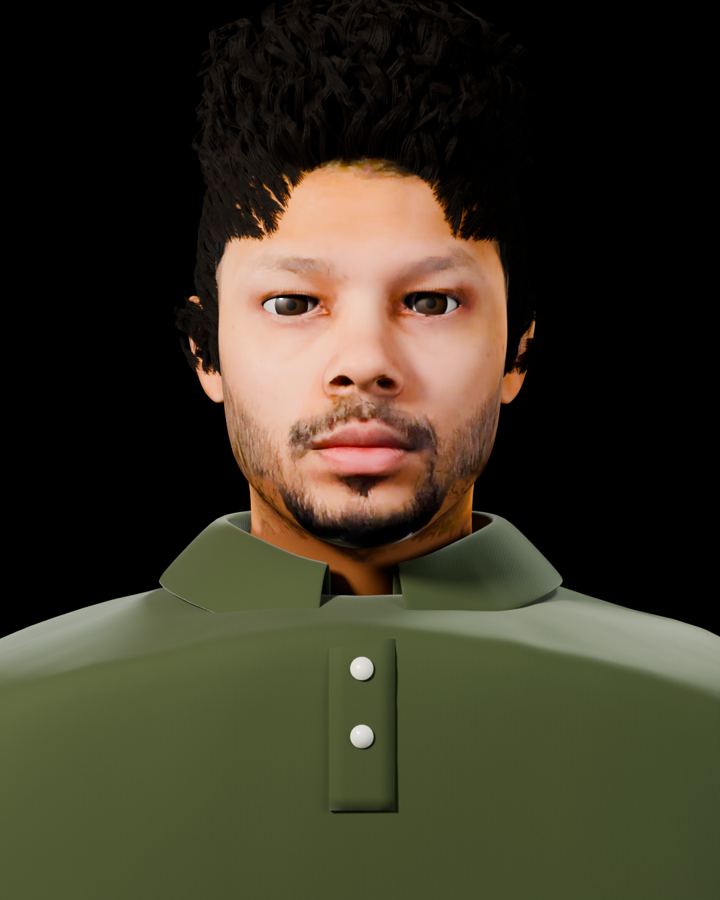 | 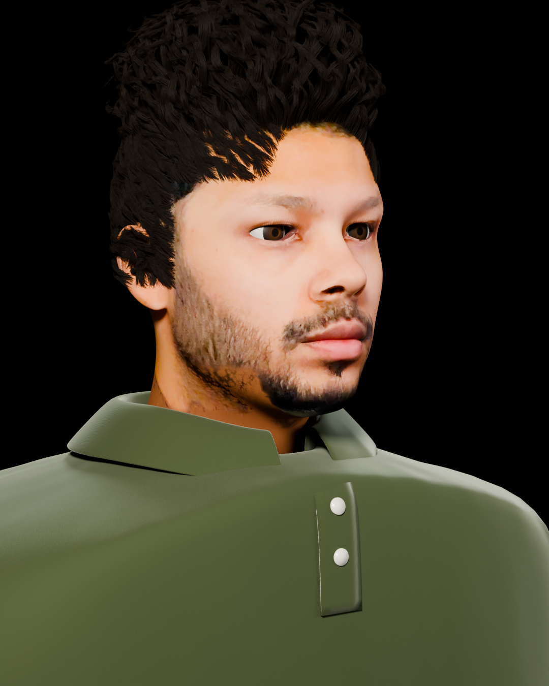 | 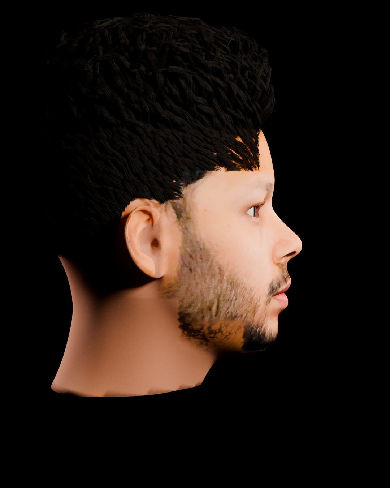 |

This repo documents every attempt: what I tried, what the AI did, what each result looked like, and why it worked or failed.

## At a glance

| | |
|---|---|
| Agent | Claude Code, driving Blender through the Blender MCP server |
| 3D software | Blender 5.2, KeenTools FaceBuilder (add-on), Brush 0.3 (Gaussian splatting), three.js |
| Capture | iPhone 14 Pro Max: photos and a 13-second video |
| Hardware | MacBook with Apple M4, 16 GB RAM |
| Cost | $0 |
| Time | About 3.5 hours of hands-on work across 9 approaches plus a review pass |
| Output | A 6.9 MB GLB with separate eyeballs, in a web viewer where the eyes follow the cursor |

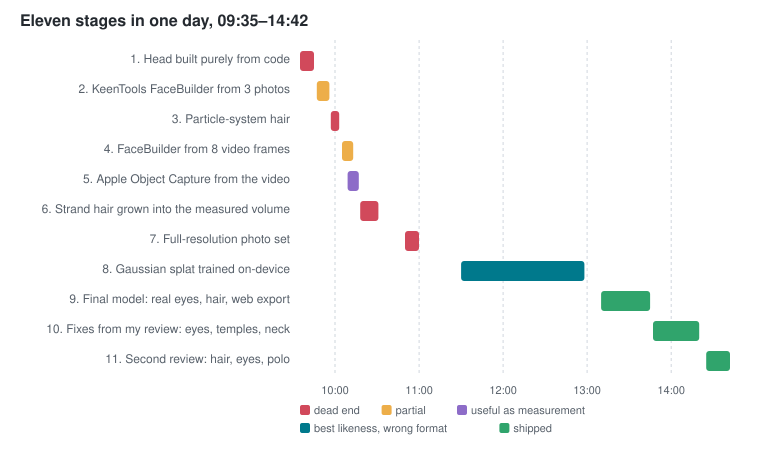

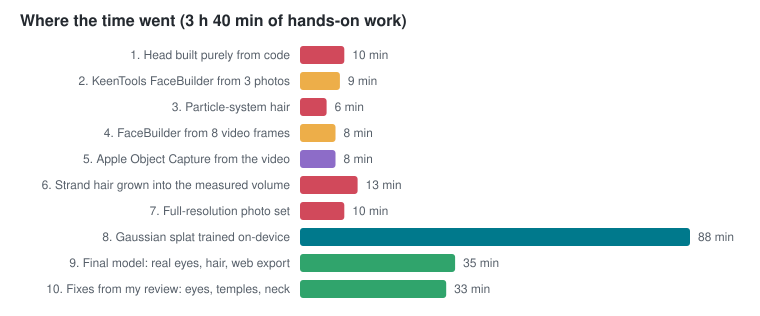

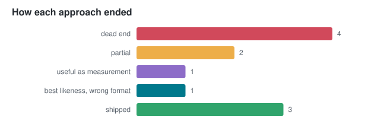

## The journey

Full data for every stage, including inputs, tools, method, result and lesson, is in [`data/timeline.json`](data/timeline.json). The charts above are generated from that file by [`tools/make_charts.py`](tools/make_charts.py).

### 1. Head built purely from code: dead end
The agent traced my outline in a front and a side photo and built a mesh through it.
**Lesson:** two outlines describe a silhouette, not a face.
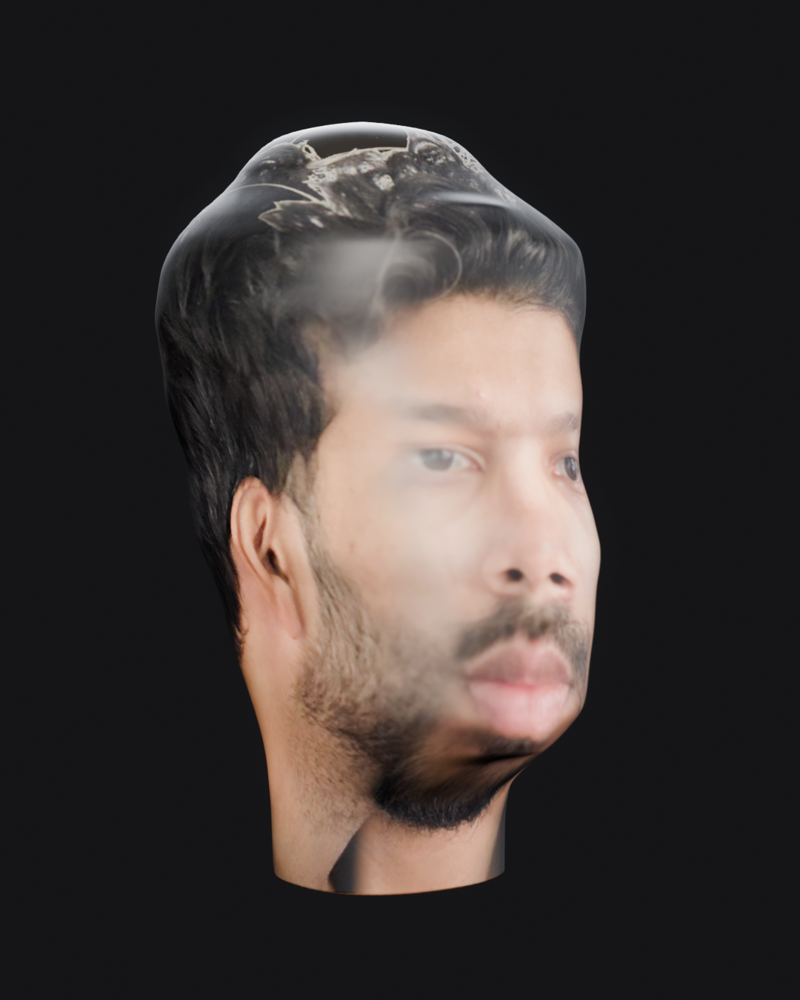

### 2. KeenTools FaceBuilder from 3 photos: partial
The agent installed FaceBuilder from a local folder and drove its face detection from Python. The result had real 3D form, but its shape stayed close to a generic average head.
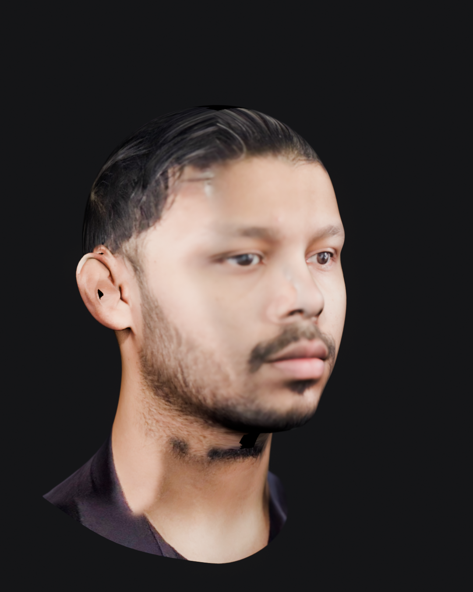

### 3. Particle hair: dead end
Six iterations of Blender's particle hair. It looked like a knitted cap. One bug: Blender silently reset the hair length to 4 m whenever another setting changed.
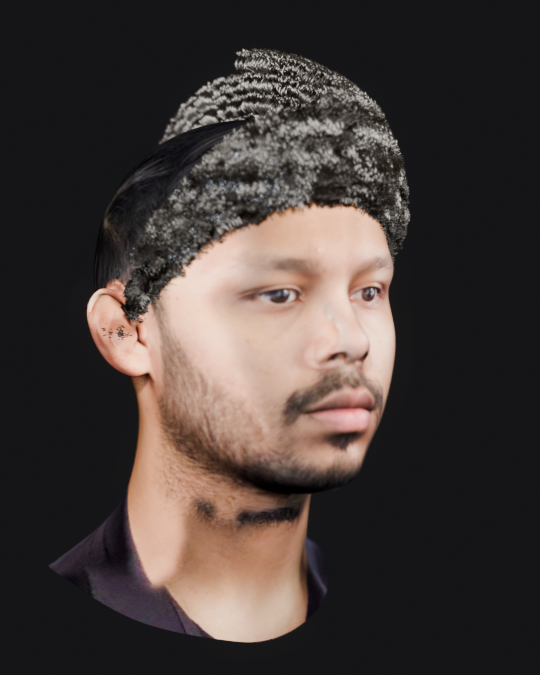

### 4. FaceBuilder from video frames: partial
A Swift tool written by the agent pulled frames from a phone video, and FaceBuilder fitted 8 angles automatically. This became the base of the final model.
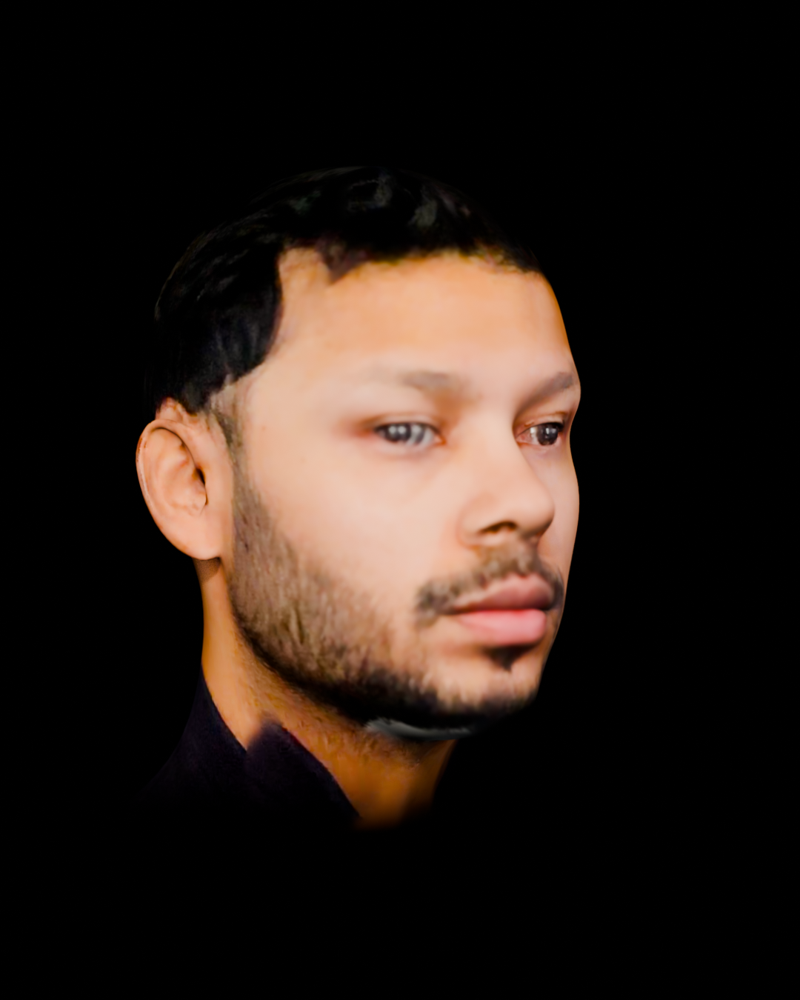

### 5. On-device photogrammetry (Apple Object Capture): useful as measurement
Got the volume of my hair right, but its surface came out smooth like a beret. The scan was aligned to the face to within 1.4 mm.
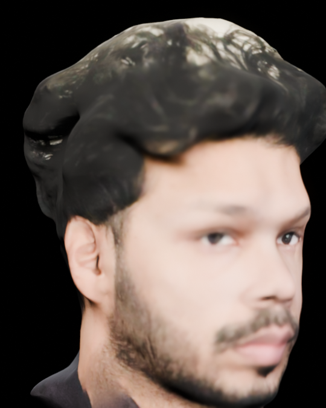

### 6. Strand hair grown into the measured volume: dead end
About 190,000 strands grown into a hair volume carved from 8 calibrated views. Technically interesting, but it read as tight rope curls, and a masking rule left my temples bald.
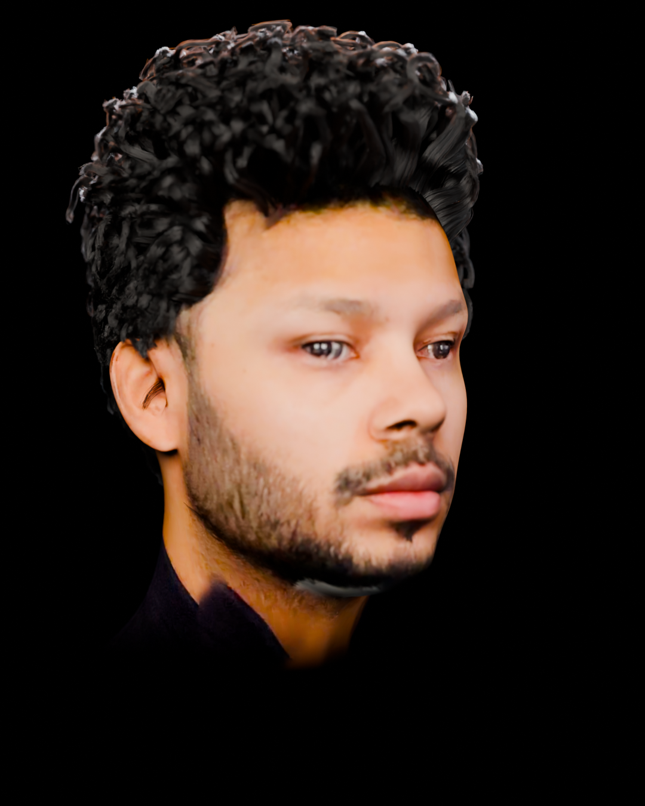

### 7. Full-resolution photo set: dead end
Failed because I turned my head instead of the camera moving around me, which produced a flat mask.
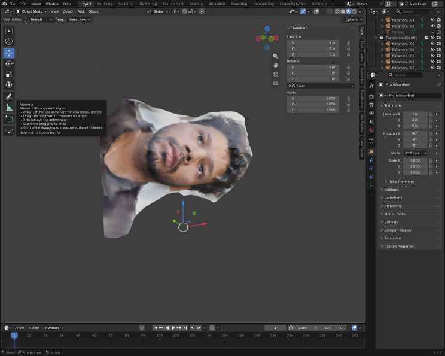

### 8. Gaussian splat trained on the laptop: best likeness, wrong format
The agent exported camera positions from Apple's photogrammetry engine and trained a splat with Brush on the M4's GPU. This was the first result that unmistakably looked like me. But a splat can't be animated, so it can't drive eye tracking or wear outfits.
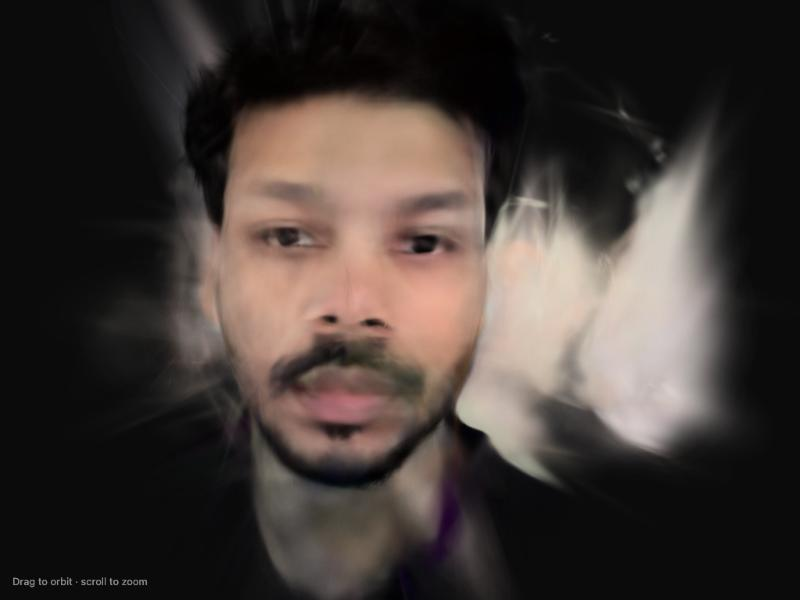

### 9. Final model: real eyes, hair, web export: shipped
- **Eyes:** almond-shaped eye openings cut to match the photo texture, eyelid edges smoothed, and separate eyeballs added behind them with a procedural brown iris and a wet coating. Both eyeballs aim at a shared target. It took 9 iterations to keep the whites inside the lids.
- **Hair and lashes:** regrown from my real hairline as detected in the texture, plus subtle eyelashes.
- **Web export:** every material baked to image textures, 121,000 hair strands converted into 6,300 hair cards, and the result exported as a GLB.
- **Viewer:** a three.js page where the head turns slightly toward the cursor and the eyes do the rest.

| Eyes, first attempt | Eyes, final | Eyes following a target |
|---|---|---|
| 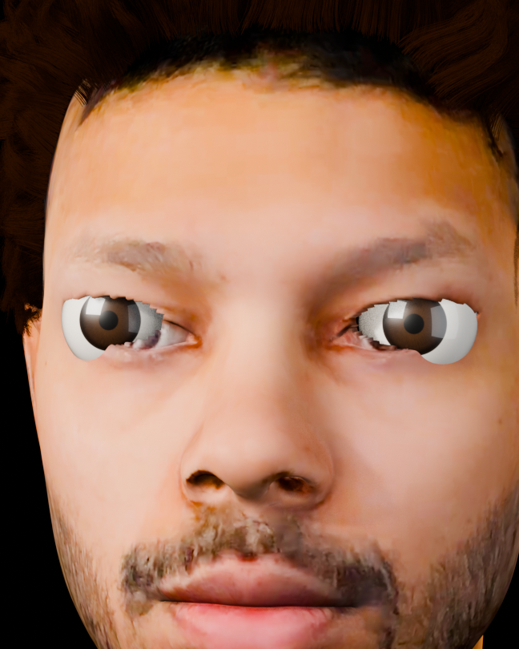 | 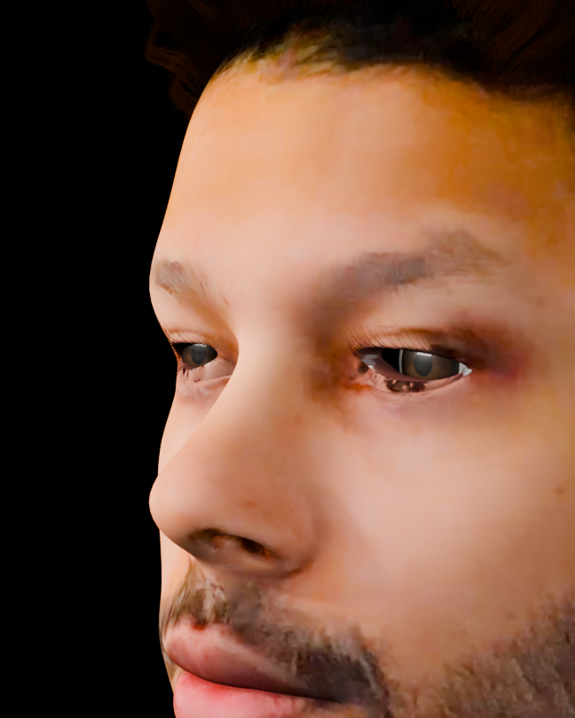 | 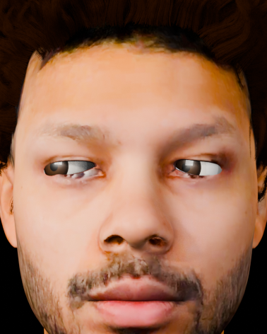 |

### 10. Fixes from my own review: shipped
After looking at the model in Blender I flagged three things. The agent then:
- **Eyes looked sideways:** re-centred each eyeball on its measured eyelid opening (they were 2–3 mm off).
- **Receding temples:** found zero hair roots in the temple corners between 38 and 62 mm above the eyes, and added about 3,000 there, plus short sideburns.
- **Neck and collar smear:** repainted the neck with my sampled skin tone, blended the seam in the shader, and modelled a crew-neck t-shirt fitted to the neck's measured shape.

| Before | After |
|---|---|
| 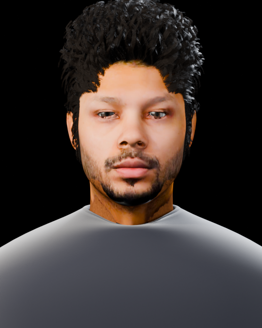 |  |

## Lessons
1. **Capture beats cleverness.** Most failures traced back to input quality: compressed video, or a moving subject.
2. **Choose the format for the end goal.** The splat gave the best likeness but can't be animated. A mesh with separate eyes can.
3. **Hair is the hardest part.** Procedural hair needs grooming to read as one specific person's hair.
4. **Eyes are where likeness lives.** Painted-on eyes made every version look dead. Real eyeballs changed it most.
5. **Review like an art director.** The agent's measurements were right, but "looks bald" and "eyes look sideways" only came from looking.
6. **AI is the operator, not the artist.** The agent installed tools, wrote pipelines in Python and Swift, and debugged them quickly. Judging whether it looked like me stayed a human job.

## Honest limits
- **Quality:** stylized-realistic, not film quality. The face shape comes from a morphable model fitted to 8 video frames, so fine detail is approximate.
- **Eyes:** no blinking or eyelid movement yet.
- **Hair:** procedural, not groomed by hand.

## Try it locally
```bash
cd web && python3 -m http.server 8000
```
Then open http://localhost:8000. The viewer loads `digital_double.glb` and three.js from a CDN.

## Screenshots: the tools in action
| | |
|---|---|
| 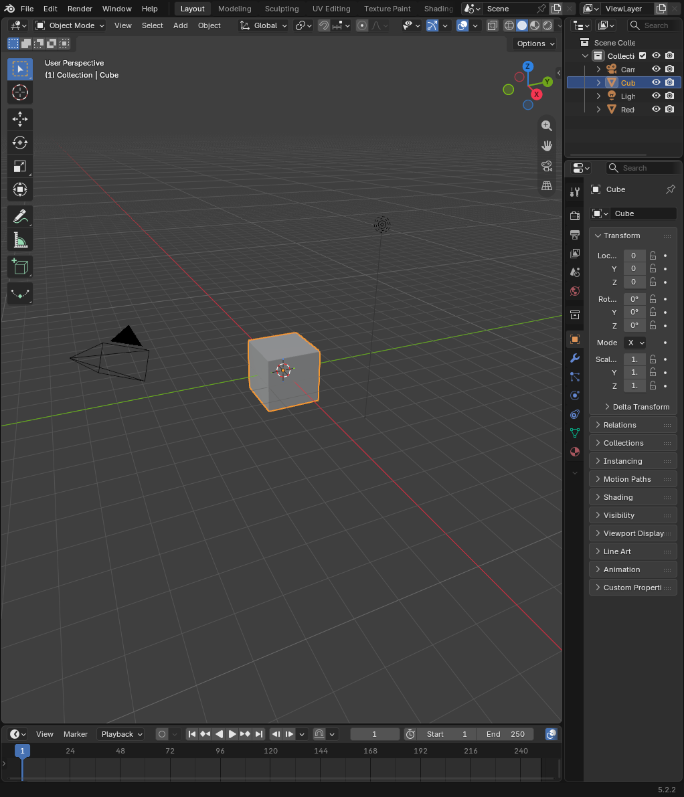 Blender connected to Claude through MCP | 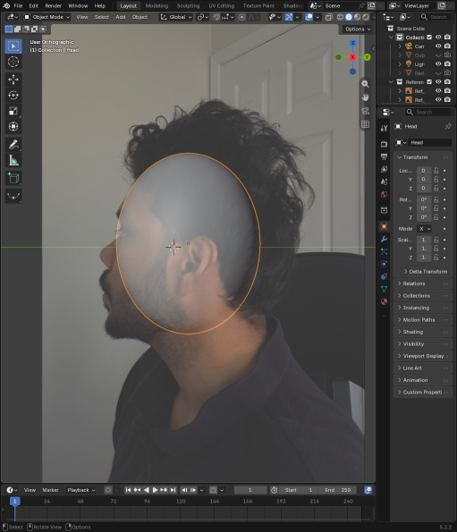 Reference photos aligned to scale |
| 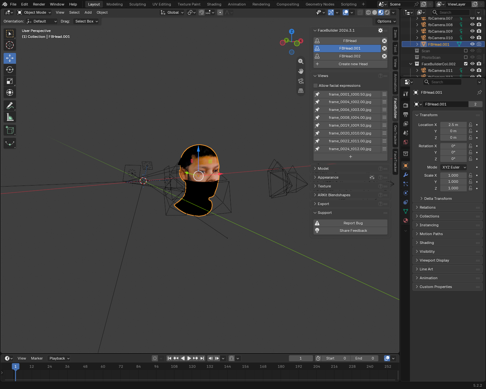 FaceBuilder: 8 video views solved, cameras around the head | 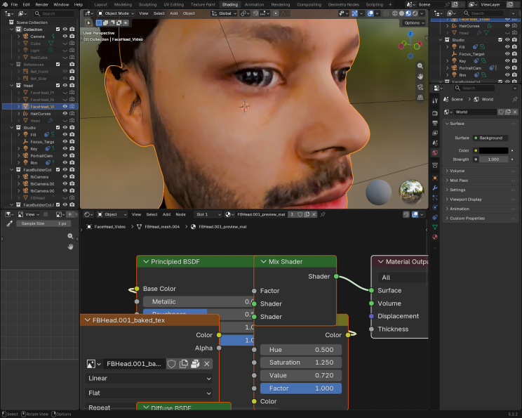 Skin shader nodes built by the agent |
| 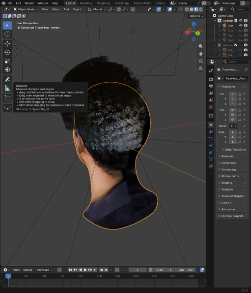 Particle hair attempt | 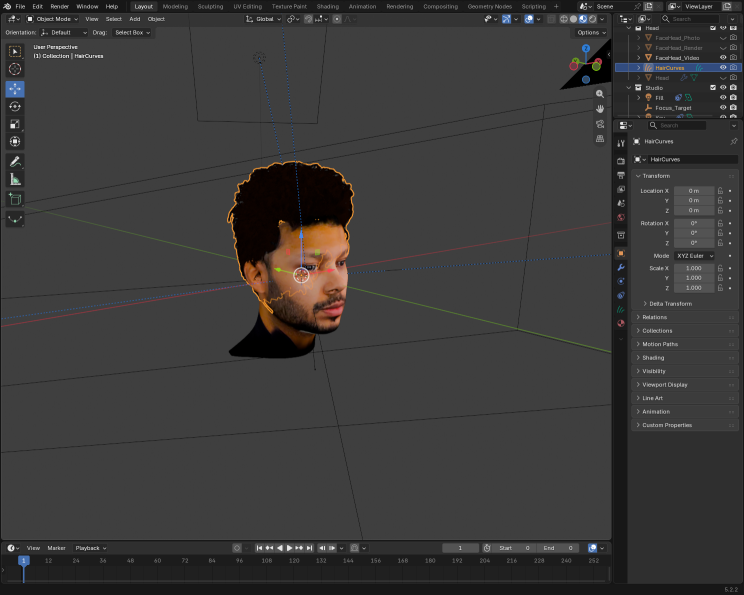 Strand hair (190k curves) |
| 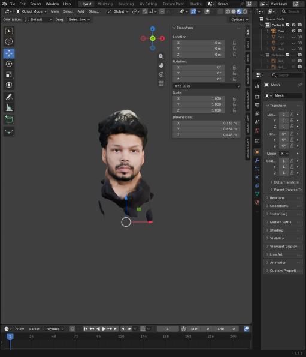 Apple Object Capture scan imported | 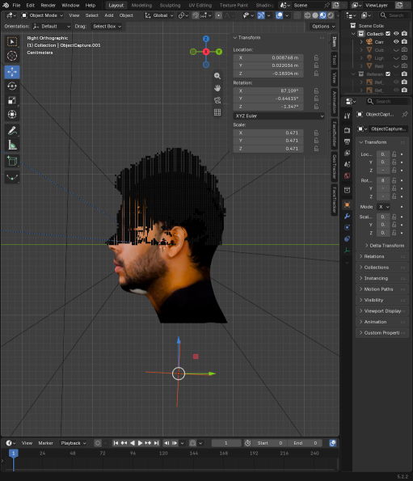 Hair volume carved from 8 views |
|  Failed capture: a flat mask | 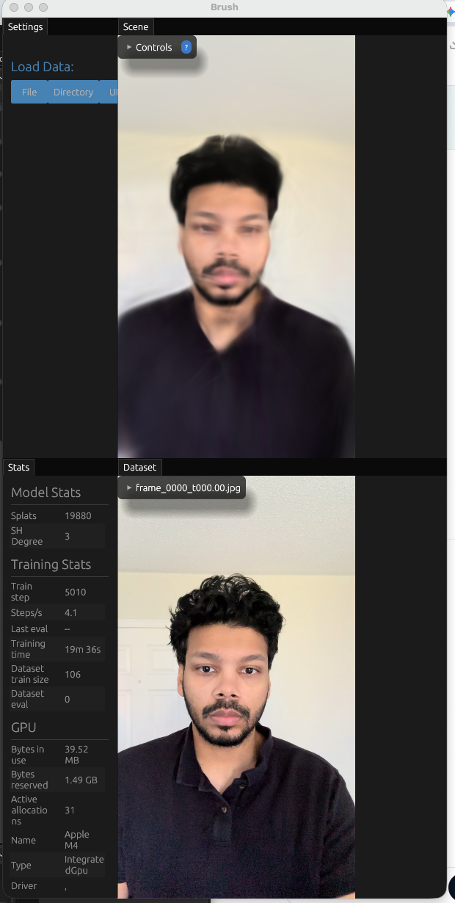 Brush training the splat on the M4 GPU |
| 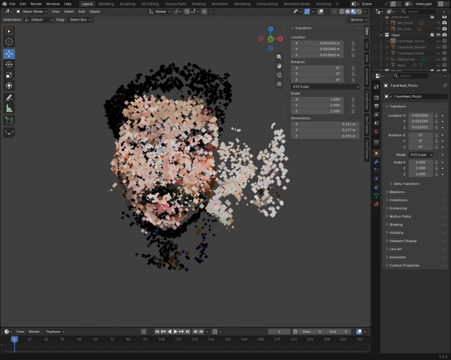 Splat as points in Blender (too crude) |  Splat in a web viewer: best likeness |
| 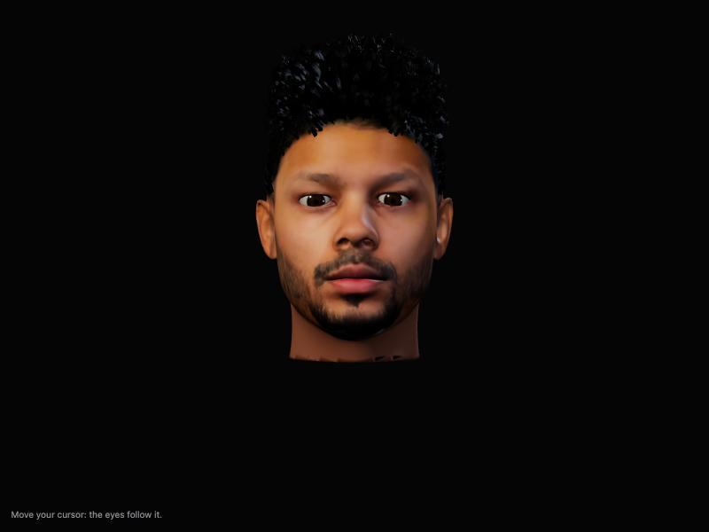 Final GLB in the web viewer | 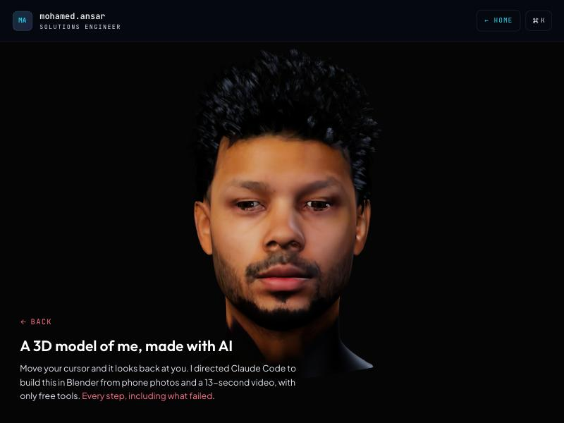 Live on the portfolio |
| 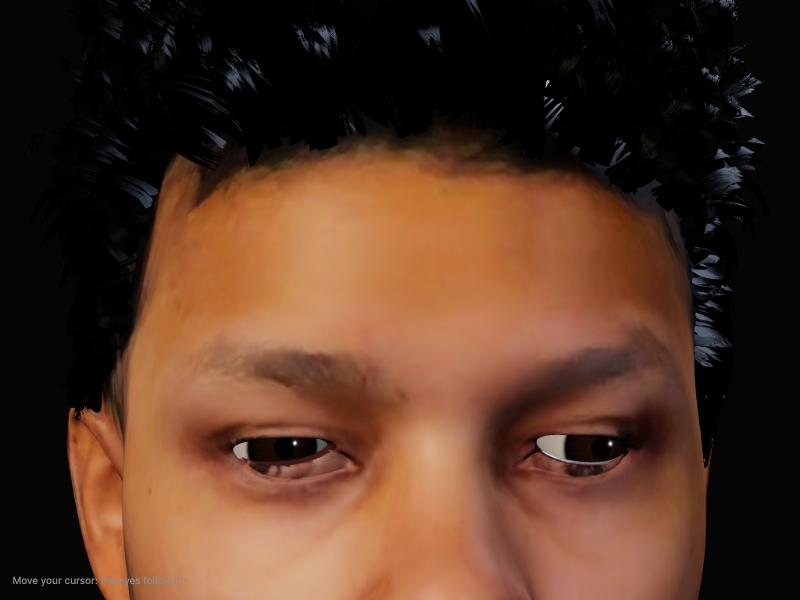 Eyes following the cursor to the right | 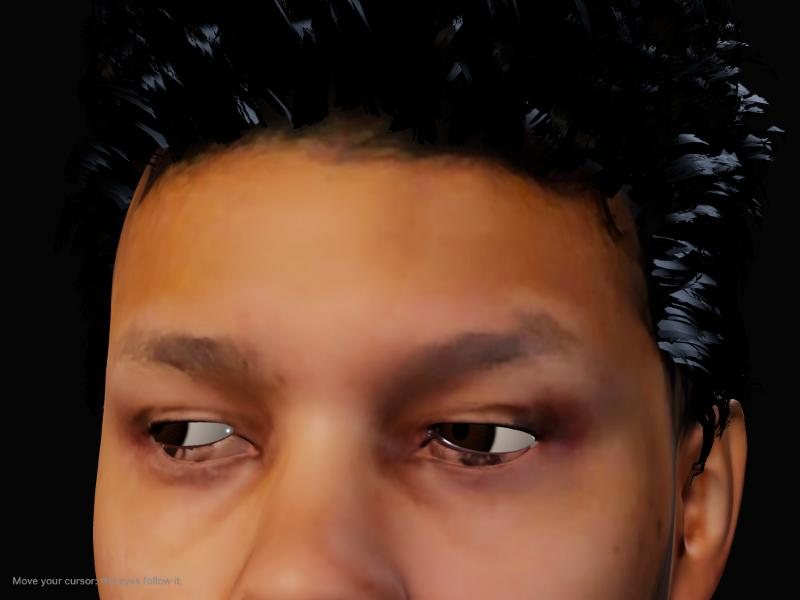 …and to the left |

## Repo layout
```
final/        hero renders of the finished model
web/          the GLB and a standalone three.js viewer
stages/       renders from each attempt
screenshots/  Blender, Brush and browser screenshots
charts/       SVG charts generated from data/timeline.json
tools/        Swift tools (frame extraction, photogrammetry, camera poses) and the chart script
data/         timeline.json: one entry per stage
```

## What's next
- Blinks and simple expressions, using FaceBuilder's built-in face shapes
- Swappable outfits
- Hair groomed by hand in Blender's sculpt mode
